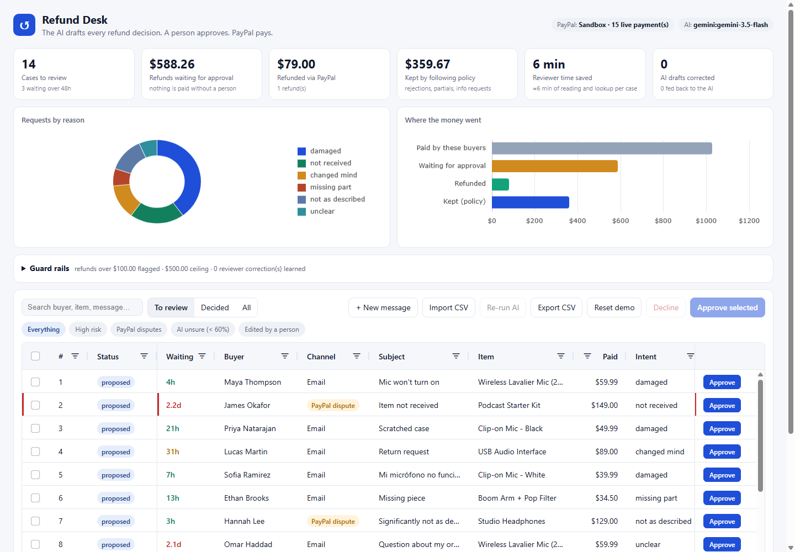
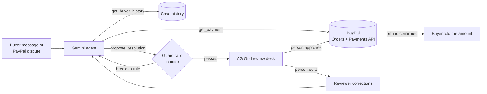

# Refund Desk

**An AI refund agent for small PayPal sellers, with a person approving every payout.**



Small shops lose hours every week to "it arrived broken", "where is my order" and PayPal disputes. Each one means reading the message, finding the order, checking the payment, checking the policy, deciding, writing a reply and issuing the refund. Fully automatic bots are risky: one wrong reply can promise a refund the seller never agreed to.

Refund Desk splits the work:

1. **The AI does the reading and thinking.** For each buyer message or PayPal dispute, a Gemini agent:
   - looks up the order and the **live PayPal capture**;
   - checks the buyer's history and the store's refund policy;
   - proposes a full refund, a partial refund, a rejection or a request for more information, with a confidence score and its reasons;
   - drafts a reply in the buyer's own language.
2. **Code enforces the guard rails.** Every proposal is checked in code before anyone sees it:
   - a refund can't exceed what's still refundable on the capture;
   - a hard ceiling applies, and large amounts are flagged for senior review;
   - the draft reply may never promise money, an amount or a timeline;
   - a proposal that breaks a rule goes back to the model with the reason, to fix.
3. **A person approves in an AG Grid review desk.** Filter, sort and search the cases, edit the action, amount or reply inline (the same guard rails apply), then approve one case or many. A confirmation shows the total refund before anything moves.
4. **PayPal pays.** Approving refunds the capture through the PayPal Payments API:
   - each refund call carries a `PayPal-Request-Id`, so a retry can't pay twice;
   - the buyer's confirmation, the first message that mentions money, is written only after PayPal confirms;
   - the reviewer can read the refund back from PayPal in one click.
5. **The AI learns from the reviewer.** When a person corrects a draft (a different amount, action or reply), that correction is fed into the AI's next decisions, so it adapts to this shop's judgement.



## Test it in 60 seconds (judges)

1. Run it (below). Twelve sample cases are already analyzed by the AI.
2. Click any row: you'll see the buyer's message, the AI's reasoning, every tool call it made, and whether the guard rails passed it.
3. Double-click **Refund** on case #3 and try `500`. The guard rails refuse it. Try `12.50`: it's saved, and counted as a correction the AI learns from.
4. Double-click **Reply** and type "We will refund you $10". It's refused, because a reply can't promise money before approval.
5. Tick a few cases, click **Approve**, read the confirmation (total, high-risk warnings), and approve. The refunds go to PayPal, and the KPIs and charts update.
6. Click **+ New message** and write your own complaint. The live AI analyzes it in a few seconds.

## Run it

```bash
git clone https://github.com/pavannani99/-refund-desk refund-desk && cd refund-desk
python -m venv .venv
.venv/Scripts/activate            # Windows. On macOS/Linux: source .venv/bin/activate
pip install -r requirements.txt
cp .env.example .env              # optional: add keys, see below
uvicorn app.main:app --port 8765
```

Open http://localhost:8765. **With no keys it still runs fully:**
- the samples load with decisions the real Gemini agent made (saved in `app/demo_snapshot.json`);
- PayPal calls are simulated;
- new messages are handled by a built-in rules engine.

Add free keys to `.env` for the real thing:

| Key | Where | Cost |
|---|---|---|
| `PAYPAL_CLIENT_ID`, `PAYPAL_CLIENT_SECRET` | [PayPal Developer → Apps & Credentials → Sandbox](https://developer.paypal.com/dashboard/applications/sandbox) | Free |
| `GEMINI_API_KEY` | [Google AI Studio](https://aistudio.google.com/apikey) | Free tier, no card |

> **Use a US sandbox business account.** The sample orders are paid with PayPal's sandbox test card, and sandbox business accounts from some regions (for example India) can't take card payments. In the PayPal Developer Dashboard go to **Testing Tools → Sandbox Accounts → Create account**, choose **Business** and **United States**, then **Apps & Credentials → Create App** (Merchant) linked to that account, and use its keys. The header shows whether payments are live sandbox payments or simulated.

With PayPal keys, every sample order gets a real captured sandbox payment, made with PayPal's test card. Approving a refund in the grid refunds that capture, and you can see it in your sandbox business account.

To re-record the saved AI run with your own key: `python -m app.snapshot`. Tests: `pip install pytest && pytest`.

## How it's built

| Part | What it does | File |
|---|---|---|
| PayPal | OAuth client credentials. Orders v2 (create and capture). Payments v2 (get capture, refund, get refund). `PayPal-Request-Id` idempotency keys. | `app/paypal.py` |
| AI agent | Gemini function calling (`get_payment`, `get_buyer_history`, `propose_resolution`) in a loop of up to 6 turns. Rejected proposals go back with reasons. Reviewer corrections are added to the prompt. Daily-quota model fallback and retries. | `app/agent.py` |
| Guard rails | Refund limits, no-promise reply check, risk rating, confirmation written only after the refund. | `app/policy.py` |
| Review desk | AG Grid Community and AG Charts Community (see below). | `static/app.js` |
| API | FastAPI with SQLite. One worker queue keeps the AI inside free-tier rate limits. The public demo caps live AI use per hour, and a stale analysis can't overwrite data after a reset. | `app/main.py` |
| Saved AI run | Real Gemini proposals for the samples, so the hosted demo starts instantly and never burns the free quota. | `app/snapshot.py` |

### AG Grid features used (all Community)

- **Selection and approval:** multi-row checkbox selection with a pinned selection column and selectable-row rules; a per-row **Approve** button (cell renderer, pinned right).
- **Inline editing:** select, number and large-text popup editors, validated on the server, with failed edits rolled back; **undo/redo** of edits (Ctrl+Z).
- **Filtering:** column filters (text and number), quick-filter search, an external filter for the To review / Decided / All views, and filter-model quick chips (High risk, PayPal disputes, AI unsure, Edited).
- **Display:**
  - a value-getter column ("Waiting") with deadline colouring;
  - row-class rules for risk;
  - cell renderers for status, action, sentiment, risk and a confidence bar;
  - **cell change flash** when the AI or a person changes a value;
  - a pinned totals row;
  - tooltips;
  - pagination with a page-size selector;
  - custom loading and no-rows overlays.
- **Other:**
  - grid state (column order, size, sort, pinning) saved and restored with `initialState` and `onStateUpdated`;
  - CSV export;
  - light and dark Quartz themes;
  - AG Charts for the donut and bar charts.

## Tools used

- **PayPal Developer Platform (sandbox):** Orders v2 and Payments v2 (captures and refunds).
- **Google Gemini (3.5 Flash, with 3.8 Flash and 3.1 Flash Lite as fallbacks):** the agent's reasoning, tool calls and multilingual replies.
- **AG Grid Community and AG Charts Community:** the human review desk.
- **Render:** hosting (`render.yaml`).

## License

MIT
